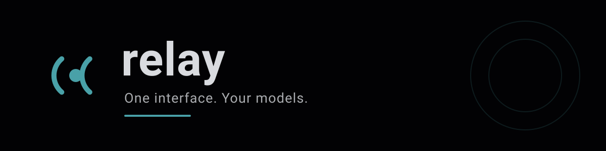

<div align="center">
  
</div>

# Relay

**One interface. Your models.**

Relay is a small, modular Rust toolkit for connecting AI providers through one
clear API. It hides the differences between backends behind a small surface:
build a request, send it, read the answer.

```rust
use relay_rs::{block_on, ChatRequest, Client, Role};

let answer = block_on(async {
    let client = Client::from_config()?;

    let request = ChatRequest::new("ollama/llama3.2")
        .message(Role::User, "Explain how DNS works.");

    let response = client.complete(request).await?;
    Ok::<_, relay_rs::RelayError>(response.text().to_owned())
})?;

println!("{answer}");
```

* Status: **0.1.0-alpha** — the API may still change.
* License: MIT.
* Repository: <https://github.com/nashiuso/relay-rs>

---

## What works today

| Area | Status |
| --- | --- |
| OpenAI compatible provider (chat, streaming, model list) | working |
| Ollama provider (chat, streaming, model list, version) | working |
| Client: model resolution, bounded retries, opt-in fallback, model cache | working |
| Streaming with cancellation, timeouts and partial output | working |
| `relay` command line interface | working |
| Configuration: TOML file, `RELAY_*` environment, precedence rules | working |
| Optional OpenAI compatible server (`server` feature) | working |
| Tool calling, image, audio, web search | **not implemented** — see [docs/roadmap.md](docs/roadmap.md) |

Relay never advertises a capability it does not have. If a backend does not
support something, the error says so instead of pretending.

## Install

Relay is a single crate with a `relay` binary and a library.

```bash
# from a checkout
cargo install --path .

# with the optional HTTP server
cargo install --path . --features server
```

Rust 1.85 or newer is required (edition 2024).

## Quick start

```bash
relay init                       # write ~/.config/relay/config.toml
$EDITOR ~/.config/relay/config.toml

export OPENAI_API_KEY=sk-...     # keep secrets in the environment

relay providers                  # what is configured
relay models                     # what the providers offer
relay doctor                     # is the setup working

relay chat -m openai/gpt-4o-mini -p "Write a haiku about TCP"
relay chat -m ollama/llama3.2 --interactive
```

Every command understands `--json` for machine readable output, `--quiet` to
suppress everything but results and errors, and `--no-color` when the output is
piped into a file.

## Configuration

Relay reads its configuration from a TOML file, from `RELAY_*` environment
variables and from command line options, in that order of precedence
(command line > environment > file > defaults).

```toml
default_model = "ollama/llama3.2"
timeout_secs = 120
max_retries = 2

[providers.ollama]
type = "ollama"
base_url = "http://127.0.0.1:11434"
model = "llama3.2"

[providers.openai]
type = "openai-compatible"
base_url = "https://api.openai.com/v1"
api_key_env = "OPENAI_API_KEY"
model = "gpt-4o-mini"
```

The full reference lives in [docs/configuration.md](docs/configuration.md); a
commented example file is in [`config.example.toml`](config.example.toml).

## Documentation

| Document | Content |
| --- | --- |
| [docs/getting-started.md](docs/getting-started.md) | Install, configure, first request |
| [docs/configuration.md](docs/configuration.md) | Every file key and environment variable |
| [docs/providers.md](docs/providers.md) | The shipped providers and how to add one |
| [docs/architecture.md](docs/architecture.md) | Modules, data flow, the dependency decision |
| [docs/server.md](docs/server.md) | The optional OpenAI compatible server |
| [docs/troubleshooting.md](docs/troubleshooting.md) | Common errors and how to solve them |
| [docs/security.md](docs/security.md) | Secrets, network, logging, the server |
| [docs/roadmap.md](docs/roadmap.md) | What is planned and what is not there yet |

## Library usage

```rust
use relay_rs::{block_on, ChatRequest, Client, Role, StreamChunk};

fn main() -> Result<(), Box<dyn std::error::Error>> {
    let client = Client::from_config()?;

    // One shot.
    let response = client.complete_blocking(
        ChatRequest::new("ollama/llama3.2").user("Hello!"),
    )?;
    println!("{} (from {})", response.text(), response.provider());

    // Streaming.
    let mut stream = client.stream_blocking(
        ChatRequest::new("ollama/llama3.2").user("Tell me a long story"),
    )?;
    for chunk in &mut stream {
        if let StreamChunk::Text(text) = chunk? {
            print!("{text}");
        }
    }
    Ok(())
}
```

`client.complete(...)` and `client.stream(...)` are asynchronous and can be
awaited from any runtime; `client.complete_blocking(...)` and
`client.stream_blocking(...)` are the blocking core. Relay ships a tiny
`block_on` for programs that do not use an async runtime.

## The optional server

```bash
cargo install --path . --features server
relay serve --port 8080
```

The server speaks the OpenAI chat completion API, binds to `127.0.0.1` by
default and refuses to start on a remote interface without an explicit opt-in
and an API key. See [docs/server.md](docs/server.md).

## Zero dependencies — and why

This build of Relay has **no third party crates**: the JSON reader and writer,
the TOML subset parser, the URL parser, the HTTP/1.1 client, the HTTP server,
the command line parser and the asynchronous primitives are all part of the
crate and are covered by the test suite.

The reason is the environment this release was built in: the crate registry
was not reachable, so `tokio`, `reqwest`, `axum`, `serde` and `clap` could not
be fetched. The result is a crate that builds anywhere a Rust toolchain is
available, with a small, auditable surface — and with the honest drawback
that it implements a lot itself.

What that means in practice:

* **TLS** uses the `openssl` command line tool as a byte tunnel. It is not
  available on every system, and it is slower than a native TLS stack.
* **Only HTTP/1.1** is supported. There is no HTTP/2, no connection
  multiplexing and no Brotli or gzip decoding.
* **The TOML parser is a subset**: tables, strings, integers, floats,
  booleans, arrays and inline tables. Dates, dotted keys and multi line basic
  strings are not supported.
* **The JSON parser** covers the whole grammar except that it is not a
  streaming parser and does not preserve the order of object keys.
* **The asynchronous API is a facade** over the blocking core. It runs the
  request on a worker thread, so it can be awaited from any runtime, but it
  does not integrate with the reactor of the runtime you use.

The planned upgrade path is documented in
[docs/architecture.md](docs/architecture.md#the-dependency-decision): replace
the transport with `reqwest` and `rustls`, the parsers with `serde` and
`toml`, the server with `axum` and the asynchronous facade with real `async`
functions, while keeping the public API of the crate stable. The module
boundaries were drawn with that migration in mind.

## Development

```bash
cargo fmt --all -- --check
cargo clippy --all-targets --all-features -- -D warnings
cargo test --all-features
cargo doc --no-deps --all-features
```

The test suite is hermetic: it starts a local mock HTTP server and never
touches the network, so no API key is needed to run it.

## Notes on providers, quotas and pricing

Relay is a client. It does not host models, it does not resell access to them
and it does not make any promise about free tiers, quotas, availability or
pricing — those belong to the provider you configure. Relay does **not**
offer unlimited or free inference; an API key that you own is used with the
provider you named, under that provider's terms.

## License

MIT — see [LICENSE](LICENSE).
